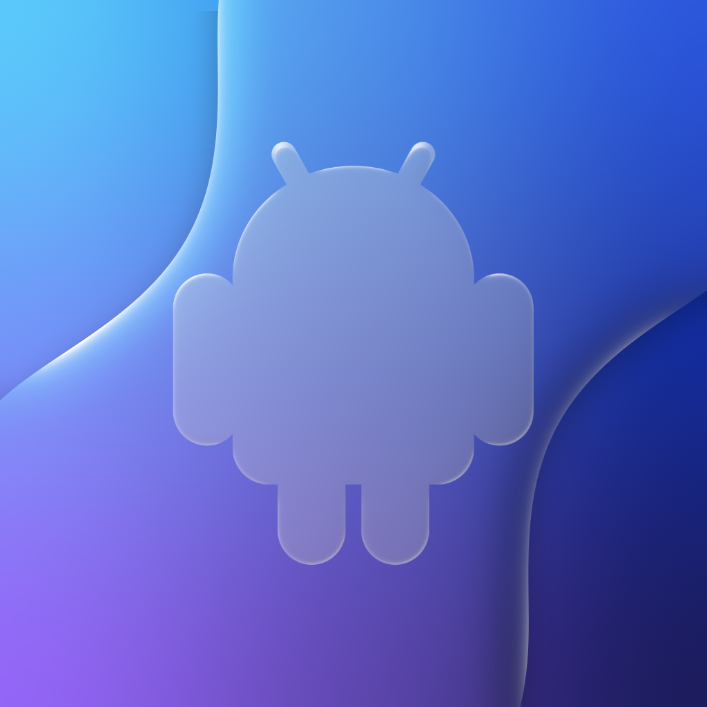

# Husk

The text bellow is not what huskpatch was used to be, it was a fork of husk to fix android startup issues like lag and freezes and crashes before a single frame was drawn. Leviidev put these new changes from this fork into official husk so now my job is done, husk is fixed, thank you guys for the support, i might still make updates but i will focus on my other projects more.

> **HuskPatch 3.6.0** is the latest official [Husk](https://github.com/Leviidev/Husk) code (Husk 3.0 and after: Compatibility
> List, Godot 4, OBB expansion files, CJK fonts, .NET for Android, battery/clock/locale following the phone...) with these additions:
>
> - **Android OS mode** (Settings › Appearance › Android OS): HuskPatch's interface replaced by LineageOS 22's (Android
>   15) -- a lock screen you swipe up, a home screen with your games and apps, an app drawer with the whole library, recents, and
>   Android's navigation: **3-button or gesture navigation** (Settings › System › Navigation mode; swipe up for home,
>   up and hold for recents, in from either edge for back). Games and apps open straight into the app, full screen.
>   Turns on the two options below with it.
>   - **Notification shade and Quick Settings**: pull down from the status bar (or anywhere on the home screen) for
>     the clock, notifications (your downloads) and tiles that work -- Internet, Flashlight, Dark theme, JIT,
>     Navigation mode, Battery Saver, Screen lock, Recent apps -- and a brightness slider; pull further for all of them.
>   - **LineageOS 22 look**: its teal wallpaper (or the older orbit one, or Material shapes); a home screen with the
>     clock widget and Trebuchet's dock of system apps; AOSP 15's lock screen -- the large clock in the middle, or the
>     small one top left with your notifications as cards under it, "Unlock for all features and data" until the first
>     unlock, optional flashlight / Do Not Disturb shortcuts; heads-up notifications; Android's dialogs instead of iOS alerts.
>   - **Android 16 as LineageOS 23.2 has it** (from recordings of the real thing): home pages with widgets (clock,
>     a Music player for what plays in Apple Music, battery, at a glance) you add from the long-press menu (Wallpaper &
>     style, Widgets, App list, Home settings), resize by their edge dots and drag onto Remove; double-tap to sleep;
>     the shade and Quick Settings with Android 16's big and round tiles, the Expressive brightness slider, the Internet
>     and Cast dialogs, Silent notifications and history / Clear all; recents with each app's last picture and its
>     menu (App info, Split screen, Screenshot, Clear) and real split screen; apps that grow out of their icon with a
>     splash; "Phone is starting…" after the first unlock; the notification permission prompt; System updates (checks
>     HuskPatch's releases) and Gestures in Settings; the shade and drawer follow your finger.
>   - **Make it yours** (3.4): colours from the wallpaper as on Android (tonal spot by default; vibrant or monochrome),
>     your own photo as the wallpaper, icon shapes (circle, squircle, rounded square, teardrop, square); arrange the home
>     screen -- hold an app to move it, drop it on another for a folder, on the dock, or on Remove; "Add to Home screen"
>     from the drawer; 4 or 5 columns, 4 to 6 rows -- edit Quick Settings (reorder, remove, add, large or icon tiles),
>     status bar options (battery %, seconds, notification icons). Google Play looks like Google Play. Apps open out
>     of their icon as on Android 16, and the shade and drawer open from easier swipes.
>   - **3.5, closer to Android 16**: Quick Settings' real tile editor (the tiles in an accent frame with minus badges;
>     select one to move it or drag its edge handle to resize; tiles to add by category with plus badges; the reset
>     arrow), the tapped icon tile's name in the footer, LineageOS 23.2's default tiles, the Screen record tile with
>     Android 16's dialog, a 3-second countdown, the red status bar chip and the video saved to Photos, and the empty
>     "No notifications" panel. Recents' **Desktop**: an app in a window with a caption bar (its menu, minimise,
>     maximise, close) that you move and resize. Motion uses Material 3 Expressive's springs and Android's emphasized
>     window transitions.
>   - **3.6, apps in Android OS mode**: open apps are square to the screen (no more rounded, cut-off corners), and
>     the 3 buttons and the gesture handle sit at the very bottom in place of iOS's home indicator. An app in landscape
>     gets the whole screen (immersive mode): swipe in from the right edge (or up from the bottom, down from the top) to
>     show the status bar and the navigation over it for a few seconds. Fullscreen games get the status bar and the
>     shade the same way. Android apps work in split screen and Desktop windows, and opening another Android app
>     restarts HuskPatch straight into it (one engine per run). New blue icon; the green one is still in Settings.
>   - **Developer options** (Settings › Testing › System): hide the status bar or the navigation/gesture bar, skip the
>     lock screen, no heads-up notifications, animator duration scale (off to 10x), disable blur, plain black
>     wallpaper, Show taps and Show refresh rate.
>   - **Custom Android firmware** (developer toggle in Settings › Testing › System): boot the Android machine from your
>     own image -- for example a debloated build -- instead of LineageOS 23.2. Any complete arm64 disk that boots with
>     UEFI (GPT with an EFI system partition), as qcow2 or raw .img, gzipped or not. Each image keeps its own data and
>     snapshot; switch back to Husk's image at any time. OTA zips, sparse system.img files and boot.img files are
>     partitions of a phone, not bootable disks, and are refused with an explanation.
>   - **Android 13 look** (developer toggle: tap Build number seven times, then Settings › System › Developer options,
>     or Settings › Testing): LineageOS 20 copied from the real thing -- its wallpaper and Monet colours, its app icons,
>     lock screen, shade and Quick Settings (pill tiles, brightness slider, pages of tiles, power menu with Power off,
>     Restart and Screenshot), home screen and dock, full-screen app drawer, recents, filled navigation buttons, flat
>     Settings lists -- in portrait and landscape. Controls stay Material 3 Expressive.
>   - **System apps**, as LineageOS ships them, working through the iPhone where iOS allows: **Phone** (dialpad,
>     recents, favourites; calls go through iOS), **Messaging** (conversations; texts go through iOS's message sheet),
>     **Contacts** (the iPhone's, with new contacts), **Browser** (Jelly: address bar, incognito, desktop site, search
>     engine), **Camera** (Aperture: photos to your library, flash, grid, zoom, QR codes), **Clock** (alarms and timer
>     as notifications, world clock, stopwatch), **Calculator** (scientific row, history) and **Files** (Internal storage
>     and HuskPatch's files: categories, recents, search, preview, share, rename, new folder, import from the iPhone).
>   - **Screen lock** (Settings › Security & privacy): None, Swipe, Pattern, PIN or Password, with AOSP's bouncer (PIN
>     pad, pattern grid, password field; five wrong tries wait 30 seconds) and a pretend **Fingerprint Unlock** you
>     enrol by touching the sensor. A look, not security: the iPhone's passcode still protects your data.
>   - **Testing** (Settings › Testing, also in HuskPatch's own Settings): every Material 3 Expressive component, the
>     palette, Android's dialogs, toasts, notifications, permission and file dialogs, the lock screen, the overscroll
>     effect, the translation layer's state, and **installing APKs** with Android's package installer.
>   - **Play Store app** laid out like Google Play: Games, Apps, Search and You tabs, chips for For you / Top charts /
>     Categories, carousels, and an app page with Install, screenshots and About.
>   - **Settings app** laid out like Android 16's: Network & internet, Connected devices, Apps (each app's permissions
>     and special app access), Display & touch, Wallpaper & style, System, About phone (tap Build number seven times).
> - **Android permissions** on the translation layer: when an app asks for a permission, Android's dialog appears. If
>   iOS guards the same thing (camera, microphone, location, photos, contacts, calendar, notifications, Bluetooth),
>   allowing it goes on to the iPhone's own prompt; if it is Android's alone (phone, SMS, display over other apps...),
>   only Android asks. Change them later in Settings › Apps.
> - **Files from the iPhone**: when an app on the translation layer opens a file (Android's file chooser,
>   `ACTION_GET_CONTENT` / `ACTION_OPEN_DOCUMENT`, the photo picker, Flutter's file_picker), the iPhone's Files picker
>   appears (the Photos picker for photos and videos, a folder picker for `ACTION_OPEN_DOCUMENT_TREE`). What you pick is
>   copied into the app's own storage (Download, Pictures or Movies on its sdcard) and handed to the app as a document,
>   with its name and size. The other way: a document the app creates is saved to Files, and a file it opens or shares
>   goes to Quick Look or the share sheet.
> - **Apps can close themselves**: finishing the last screen, `System.exit`, `killProcess` or moving to the back closes
>   the app (back to the launcher in Android OS mode) instead of leaving a black screen or quitting HuskPatch.
> - **Android's overscroll**: lists stretch at their ends as on Android 12+, or glow as on Android 5-11 (Settings ›
>   Display & touch › Overscroll effect), instead of iOS's rubber band.
> - **Android 16 Style**: Material 3 Expressive with [ExpressiveUI](https://github.com/edenkollcinaku/ExpressiveUI)'s
>   components (switches, buttons, menus, loading and progress indicators, carousel), and colours made the way Material
>   makes them: each role a tone (L*) of a palette from your accent, Android's navigation and search bars,
>   Material's back button, segmented buttons and switches, large rounded cards and pill buttons. No Liquid Glass.
> - **Material You in Apps**: apps on the translation layer get Android's dynamic colours, made from your accent.
> - **Resizable windows** (Multitasking): Android apps and Flutter apps lay out again at the window's new size; games
>   keep their shape as you resize or pinch, so there are no black bars and nothing is stretched. Maximise fills the
>   whole screen -- no rounded corners, no title bar (tap the handle at the top for it) -- and games start at
>   full-screen resolution, so a maximised game has no black borders.
> - **Android status bar** over apps in portrait, and **no grey borders** around apps.
> - HuskPatch's own icon and name; Husk's original icon is still there as **Automatic Legacy**, with the others.
>
> Upstream's PS4 games (libhuskps4) are not in these builds: the PS4 layer needs Leviidev's unpublished FEXCore fork.
>
> HuskPatch needs iOS 16 (upstream Husk now runs on iOS 15.5; HuskPatch's Android UI is built on iOS 16 SwiftUI).
>
> Builds: **Actions → Build IPA**, artifact **Husk-ipa**. Android's Java libraries in them come from the official 2.0
> release; Husk's Java framework is built from this repo. Untested builds: use
> [official releases](https://github.com/Leviidev/Husk/releases) for anything stable. The old HuskPatch 0.5.2 is on
> the [`huskpatch-0.5.2`](https://github.com/Yaryk007/HuskPatch/tree/huskpatch-0.5.2) branch.

<p align="center">
  
</p>

<h1 align="center">Husk</h1>

<p align="center">Android apps and games on your iPhone.</p>

<p align="center">
  <a href="https://itslevii.dev/docs/install">Install</a>
  ·
  <a href="https://itslevii.dev/husk">Compatibility</a>
  ·
  <a href="https://itslevii.dev">Website</a>
  ·
  <a href="https://github.com/Leviidev/Husk/releases">Releases</a>
</p>

<p align="center">
  <a href="https://github.com/Leviidev/Husk/releases"></a>
  <a href="LICENSE"></a>
</p>

Add an APK, tap it, and it opens full-screen.

- **Translation layer** — the game’s own 64-bit Android code runs on the iPhone. Husk stands in for Android around it (C library, Java, GL, Vulkan, audio, input). No Android boot; a game starts in seconds.
- **Emulation** — a full LineageOS guest under QEMU, for apps the translation layer cannot run yet.
- **PS4** — fake packages and game folders on iOS 17.4+.

## Install

Sideload with SideStore, AltStore, or TrollStore. iOS 15.5 or later.

**Guide:** [itslevii.dev/docs/install](https://itslevii.dev/docs/install)

Add this source in SideStore or AltStore (Sources › +). It also lists AetherPS4, Utsuro, Podium and Fathom:

```
https://itslevii.dev/repo.json
```

Or download `Husk.ipa` from [Releases](https://github.com/Leviidev/Husk/releases).

Games need [JIT](https://itslevii.dev/docs/jit), or they can run from [Play without JIT](https://itslevii.dev/docs/play-without-jit) after you import the certificate that installed Husk.

## Screenshots

<table>
  <tr>
    <td align="center"><br><sub>GTA: San Andreas</sub></td>
    <td align="center"><br><sub>Minecraft Dungeons</sub></td>
  </tr>
  <tr>
    <td align="center" width="33%"><br><sub>Library</sub></td>
    <td align="center" width="33%"><br><sub>Game Settings</sub></td>
    <td align="center" width="33%"><br><sub>Settings</sub></td>
  </tr>
</table>

## Building

On a Mac with Xcode, plus `meson`, `ninja`, `pkg-config`, `python3`, `xcodegen`, `qemu-img`, and a Rust toolchain with `aarch64-apple-ios`:

```sh
./scripts/ci_build.sh
```

That produces `build/Husk.ipa`. Later app-only rebuilds: `./scripts/package_ipa.sh` → `~/Desktop/Husk.ipa`.

## Licence

GPL-2.0-or-later. Husk links QEMU (GPLv2), so the shipped binary is a combined GPLv2 work. It cannot go on the App Store. See [docs/01-licensing.md](docs/01-licensing.md).
